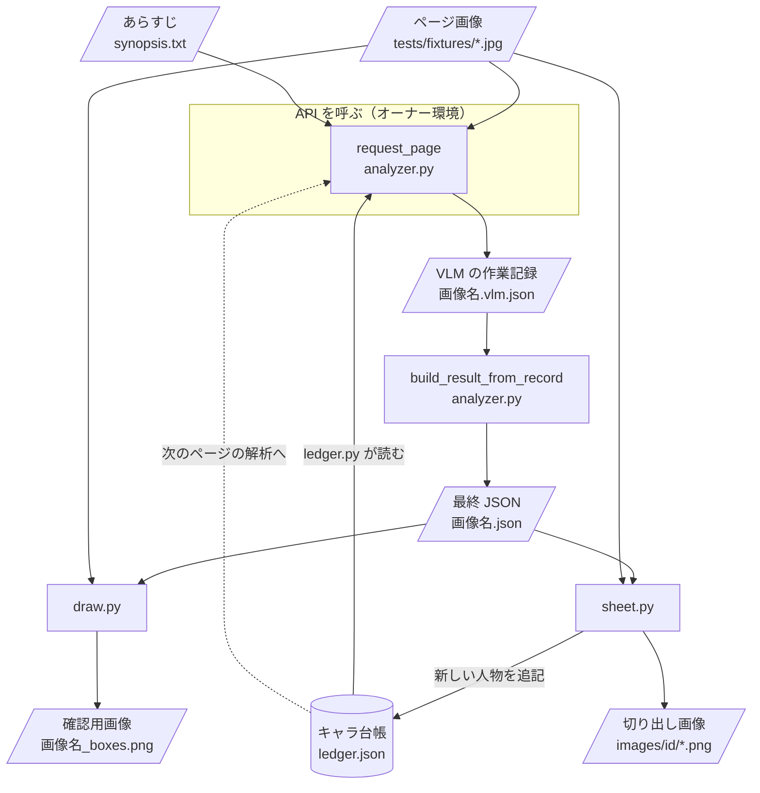
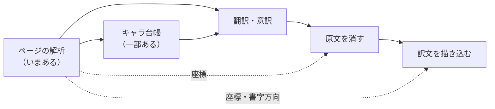

# 設計図（manga_analyzer）

この文書は、`manga_analyzer` を構成する部品とデータの流れをまとめたものです。各部品が何をしていて、データがどう流れるかを、関数ではなく**ファイル（部品）単位**で示します。
コマンドの使い方は [README](../README.md) を見てください。

> 構成（部品・ファイル・JSON の形）を変えたら、この文書も同じ PR で更新してください（CLAUDE.md のルール）。

## 全体の流れ

漫画は 1 ページずつ、前から順に読み進めます。ページを解析したら、新しく出てきた人物をキャラ台帳に追記します。次のページは、その台帳を渡して解析します（#21）。

この流れで押さえておく点は 2 つです。

- **API を呼ぶのは `request_page` だけ**です。VLM の答えは加工せずに作業記録（`.vlm.json`）に保存します。そのあとの工程（番号の確定・描画・台帳への追記）は API なしで、何度でもやり直せます（CLAUDE.md の開発ルール）。
- **番号は VLM が仮に付け、コードが確定します。** VLM の付けた番号は `tmp_` 付きの欄に残します。

## 部品

| ファイル | 役割 | 入力 | 出力 | API |
|---|---|---|---|---|
| `__main__.py` | 解析のコマンドの入口。下の部品を順に呼ぶ | 画像、`--ledger`、`--synopsis` など | 作業記録・最終 JSON（`--draw` のときは確認用画像も） | 呼ぶ |
| `analyzer.py` | 解析の中心。①画像・台帳・あらすじを VLM に送る（`request_page`） ②作業記録から最終 JSON を組み立てる（`build_result`） | 画像、台帳、あらすじ | 作業記録、最終 JSON | ①だけ |
| `schema.py` | VLM に「この形で答えて」と指定する JSON Schema。台帳の `id` を `ledger_id` の選択肢にする | 台帳の `id` の一覧 | JSON Schema | — |
| `ledger.py` | キャラ台帳を読み込んで形式を確かめる。VLM には `id`・`name`・`role`・`appearance` だけを渡す | 台帳 JSON | 台帳 dict、VLM に渡す人物の一覧 | — |
| `rebuild.py` | 作業記録から最終 JSON を作り直すコマンド | `.vlm.json` | `.json` | 呼ばない |
| `draw.py` | 最終 JSON の枠を元画像に描く（コマ＝赤、人物＝青、テキスト＝緑） | 最終 JSON、元画像 | `_boxes.png` | 呼ばない |
| `sheet.py` | 最終 JSON の不明の人物をキャラシートにまとめ、台帳に追記する。人物の写っている範囲を切り出す | 最終 JSON、元画像、台帳 | 追記した台帳、切り出し画像 | 呼ばない |
| `tests/` | 代役のクライアントを使って、API なしで上の動きを確かめる | `tests/fixtures/` | — | 呼ばない |

### analyzer.py の中身

`request_page` は、次のことをします。

1. **画像の準備**: 画像が API の上限（長辺 2576px・約 375 万画素）を超えるときは、こちらで縮小して送ります。API 側で縮小されると、モデルが答える座標と元画像がずれるためです。縮小の倍率は作業記録に残します。
2. **送るもの**: システムプロンプト（`SYSTEM_PROMPT`。何をどう読むかの指示）、台帳、あらすじ、画像、JSON Schema（`schema.py`）。
3. **受け取るもの**: VLM の答え。加工せずに `output` として作業記録に入れます。

`build_result` は、作業記録の答えを最終 JSON に直します。

- **座標**: 送った画像のピクセルから元画像のピクセルに戻し（`to_pixel_bbox`）、`{x_min, y_min, x_max, y_max}` を `{x, y, width, height}` にします。
- **人物の確定**: 台帳と一致した人物（`ledger_id` あり）は台帳の `id` を使い、`known` にします。それ以外は仮の `c1` などのままで、`unknown` にします。
- **番号の確定**:
  - コマは読む順に並べて `p1`, `p2`, … を付けます。
  - 登場はコマ＋人物で `p1-shigeo` のように付けます。
  - テキストは `p1-t1` のように付けます。
- **申し送り事項**: `notes` の中の仮の id を、確定した id に置き換えます。

## データ

### VLM の答え（作業記録の `output`）

形は `schema.py` で決めています。座標は送った画像のピクセル（`x_min` など）で、番号はすべて仮です（`tmp_id`, `tmp_reading_order`, `tmp_person`, `tmp_speaker`）。

### VLM の作業記録（`<画像名>.vlm.json`）

| 欄 | 中身 |
|---|---|
| `source` | 画像のパス、元の大きさ（`width`・`height`）、送った大きさ（`sent_width`・`sent_height`） |
| `model`・`effort`・`language` | 解析の設定 |
| `ledger`・`synopsis` | 渡した台帳とあらすじ（作り直すときに同じ照合ができるように） |
| `output` | VLM の答え（加工しない） |

### 最終 JSON（`<画像名>.json`）

翻訳など後ろの工程が使うのは、この JSON です。

| 欄 | 中身 | 翻訳での使い道 |
|---|---|---|
| `source` | 元画像のパスと大きさ | 画像に立ち返る |
| `coordinate_system` | 座標の決まり（ピクセル、左上が原点） | — |
| `page.summary` | ページの要約 | 文脈 |
| `page.reading_direction` | 読む向き（`right_to_left` / `left_to_right`） | 読む順、描き込みの向き |
| `persons[]` | ページに出てくる人物。`id`、`status`（`known` / `unknown`）、`name`、`appearance`（そのページでの姿）、`match_evidence`（台帳と一致した根拠） | 話し手の特定、呼び名をそろえる |
| `panels[]` | コマ。`id`、`reading_order`、`bbox`、`description`（何が起きているか） | 読む順、文脈 |
| `panels[].characters[]` | コマへの人物の登場（枠 1 つ）。`person` で `persons` の人物を指す。`description`、`expression`（表情）、`bbox` | 口調・感情 |
| `panels[].texts[]` | テキスト。`type`（`narration` / `speech` / `thought` / `sound_effect` / `other`）、`content`（原文の書き起こし）、`speaker`、`bbox`（吹き出しがあれば吹き出しごと） | **翻訳の対象**。原文を消す範囲・訳文を描き込む範囲 |
| `notes` | 台帳を整理する人への申し送り事項（名前が分かった、同じ人物かもしれない、など） | 台帳の更新 |
| `tmp_` の付いた欄 | VLM が付けた仮の番号 | 使わない（追跡用） |

例と細かい決まりは、README の「最終 JSON」「番号の読み方」を見てください。

### キャラ台帳（`ledger.json`）

`{"characters": [...]}` の形で、1 人分が 1 枚のキャラシートです。

- **人物の特徴**（解析時に VLM に渡す）: `id`（必須）・`name`・`role`・`appearance`
- **根拠**（VLM に渡さない。`sheet.py` が書く）: `image`・`source`・`appearances`・`lines`・`notes`

`c1`, `c2`, … はページの中だけで使う仮の id なので、台帳の `id` には使えません。`sheet.py` が追記する人物には `unk-001`, `unk-002`, … を振ります。

## これから足す部品

決まっているのは、自動翻訳までの大まかな順番だけです。中身はまだ決まっていません。

| 部品 | 位置づけ | Issue |
|---|---|---|
| キャラシートを VLM に書かせる | `sheet.py` の後ろ。切り出し画像と根拠を VLM に渡し、`name`・`role`・`appearance` を書かせる（API を呼ぶ部分と台帳に書き戻す部分を分ける） | #26 |
| 台帳の選抜・まとめ直し・訳語の対応表 | 台帳と解析の間。解析に渡す人物を選ぶ、同じ人物をまとめる、訳し方をそろえる | #21 |
| 座標の品質検査 | 最終 JSON の後ろ。座標が画像と合っているかを確かめる | #20 |
| プロンプトと出力項目をコードの外に出す | `analyzer.py` の `SYSTEM_PROMPT` と `schema.py` を、設定ファイルで調整できるようにする | #5 |
| 翻訳・意訳 | 最終 JSON（`texts`・`persons`・`summary`）と台帳から訳文を作る。文脈を見るために画像に立ち返る | — |
| 原文を消す | `texts[].bbox` の範囲から原文を消す | — |
| 訳文を描き込む | 消した範囲に、書字方向に合わせて訳文を描く | — |

部品が増えたら、「解析／翻訳／描画」などのまとまりごとの図をこの文書の上のほうに足します。
